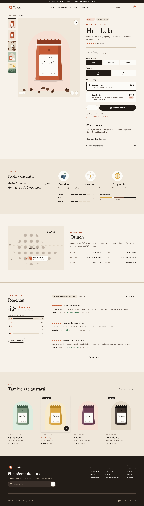
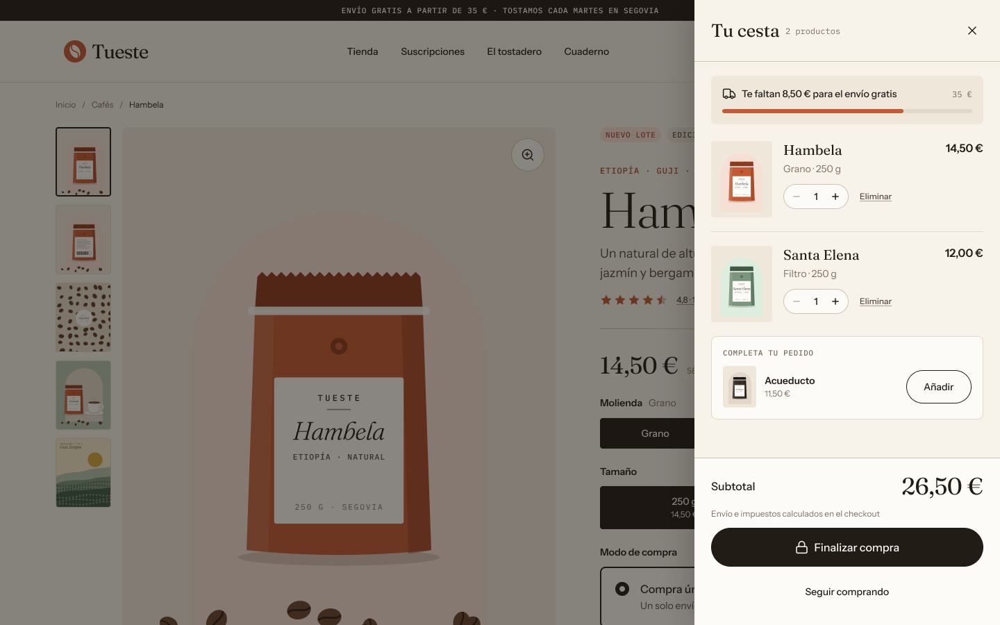
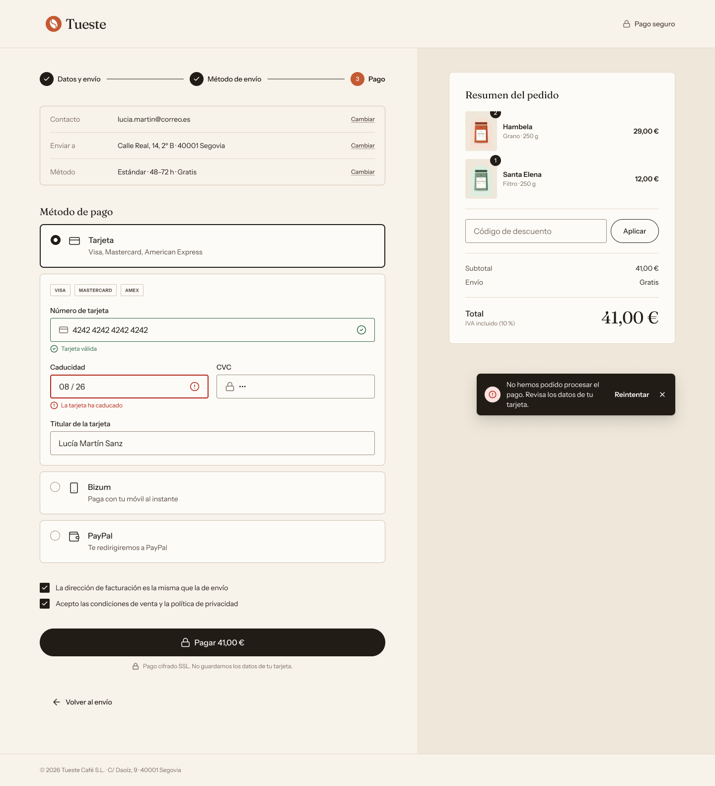
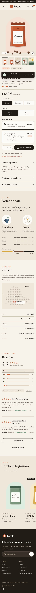

<a href="https://tueste.netlify.app"></a>

# Tueste — specialty coffee shop, from Figma to code

An online shop for a specialty coffee roaster in Segovia, built from its Figma design ([Tueste · Design System v1.0](https://www.figma.com/design/VuLHodVYIdQFsnPdJ6G1ia/Tueste)): data-driven product pages, a persistent side cart, a 3-step checkout and an order confirmation, in Spanish and English.

**[Live site ↗](https://tueste.netlify.app)** · **[Figma file](https://www.figma.com/design/VuLHodVYIdQFsnPdJ6G1ia/Tueste)** · Built by [Javier Piedra](https://jpiedra.com/en/)

> Concept project. Payment is simulated (there's no real payment gateway) and some coffees use sample content.

| Cart drawer | Checkout | Mobile product page |
| --- | --- | --- |
|  |  |  |

<sub>Screens from the Figma reference in `docs/figma/`.</sub>

## Overview

Most of an online shop's sales are won or lost in three places: the product page, the cart and the checkout. Tueste focuses on exactly those, and on making them work for everyone, with a keyboard, a screen reader or a slow phone.

## Highlights

- **Product page:** grind and size variants that instantly update the price and price per kilo, with the choice kept in the URL; one-time purchase or subscription (10 % off, every 4 weeks); tasting notes with intensity scales, full origin details and related coffees; reviews with a rating breakdown and filters.
- **Side cart:** saved between visits and synced across tabs, with a free-shipping progress bar and "undo" when removing an item.
- **3-step checkout:** the step lives in the URL (the browser's Back button works), real-time validation, clear error messages and correct autofill. **Card details are never stored.**
- **Bilingual:** Spanish and English, with prices formatted for each language and translated URL parameters (`?molienda=espresso&tamano=1kg` / `?grind=espresso&size=1kg`). The language switcher keeps the chosen variant.
- **Data-driven:** product pages are generated from `products.json`, so adding a new coffee takes minutes.

## Tech stack and decisions

**Astro 7** (static output) · **React 19 islands** · **Tailwind CSS 4** · strict **TypeScript** · **nanostores** · **Zod 4** · Vitest · Playwright + axe · Lighthouse CI.

- **Static HTML with minimal islands.** Islands visible on load use a custom `client:paint` directive (`src/directives/paint.ts`): they hydrate after the first paint, so React doesn't compete with the LCP image.
- **Illustrations rebuilt, not exported.** The design has no photos, only vector compositions. They're rebuilt from the SVG pieces exported from Figma (unmodified) plus the **real label text**, so they work for all 5 coffees and both languages, scale with their container (`cqw` units) and weigh ~1–2 KB compressed per view. Exception: the Ethiopia map (62 KB gzip, lazy-loaded).
- **Tokens with Figma's names.** Colours, spacing, radii, shadows and text styles use the same names as Dev Mode (`text/primary` → `--color-text-primary` → `text-text-primary`). Text styles are `type-*` utilities (`type-heading-h1`, `type-price-l`…). Icons are Figma SVGs used as CSS masks, taking the token colour (`currentColor`).
- **Validated data.** The catalog schema (`src/lib/schemas.ts`) is checked at build time, including that each grind × size combination exists once, that `defaultSku` exists and that the rating distribution adds up to the total.

## Accessibility and performance

- **WCAG 2.2 AA:** semantic HTML, native radios for variants (the sold-out one is `disabled` and "Sold out" is part of its name), `aria-live` announcements (variant change, added to cart, review filters), touch targets ≥ 24 px, visible focus, `prefers-reduced-motion` on every animation and high-contrast mode. The E2E tests run axe (WCAG 2.2 A/AA) on the key pages.
- **Forms:** Zod (`zod/mini`) validation when leaving each field, on every keystroke once there's an error, and on submit; errors linked with `aria-describedby`, a summary with `role="alert"` and links to each field; focus moves to each step's heading; full `autocomplete`; a Spanish postcode fills in the province.
- **Cart dialog:** a modal `<dialog>` with a focus trap, closed with Escape or a click outside, focus returned to the button that opened it.
- **No layout shift:** inlined CSS, self-hosted fonts with metric-adjusted fallbacks, immutable caching for SVGs and reserved space for everything that hydrates (CLS 0, also with an empty cart).
- **Lighthouse mobile** (measured locally on the build, simulated slow network):

  | Page | Performance | Accessibility | Best practices | SEO | CLS |
  | --- | --- | --- | --- | --- | --- |
  | Product ES / EN | 97 | 100 | 100 | 100 | 0 |
  | Listing / home | 98 | 100 | 100 | 100 | 0 |
  | Checkout | 95–96 | 100 | 100 | 66* | 0 |
  | Confirmation | 96 | 100 | 100 | 66* | 0 |

  \* Checkout and confirmation are `noindex` on purpose, which Lighthouse penalises in SEO.

### Accessibility adjustments to the Figma design

Suggested back to the design (update Figma if accepted):

| Token | Problem | Change |
| --- | --- | --- |
| `text/tertiary` #7d6e62 | 4.40:1 on `bg/page` | #73655a (5.04:1) |
| Text on `action/accent` #c45a34 | 4.18:1 | fill #a8472a (5.64:1) |
| Focus (35 % halo) | 1.55:1 | solid 2 px `border/focus` outline + halo |
| Field border `border/default` | 1.66:1 | `border/input` #908174 (≥ 3:1) |

## Getting started

Requires Node 22.12 or later (`.nvmrc`).

```bash
npm install
npm run dev        # http://localhost:4321  →  /es
```

| Script | What it does |
| --- | --- |
| `npm run dev` | Development server |
| `npm run build` | Type check (`astro check`) and static build in `dist/` |
| `npm run preview` | Serves `dist/` as in production |
| `npm test` | Unit tests (Vitest) |
| `npm run test:e2e` | E2E tests on mobile and desktop (Playwright + axe). Needs `npm run build` first and `npx playwright install chromium` the first time |
| `npm run lhci` | Lighthouse CI on mobile against the build (thresholds in `lighthouserc.json`) |
| `npm run format` | Prettier |

### Trying the checkout

Payment is simulated:

- `4242 4242 4242 4242` (or any valid card) → order confirmed.
- `4000 0000 0000 0002` → payment declined (error notice with "Retry").
- Bizum and PayPal are simulated as successful. Test discount code: `TUESTE10` (−10 %).

---

## Routes

| ES | EN | Page |
| --- | --- | --- |
| `/es`, `/es/cafes` | `/en`, `/en/coffee` | Home and coffee listing |
| `/es/cafes/[id]` | `/en/coffee/[id]` | Product page (one per coffee in the JSON) |
| `/es/checkout?paso=2` | `/en/checkout?step=2` | Checkout |
| `/es/pedido-confirmado` | `/en/order-confirmed` | Confirmation |
| `/es/proximamente` | `/en/coming-soon` | Sections without a design (subscriptions, account…) |

## Project structure

```
src/
├── content.config.ts      products and reviews collections (validated with Zod at build time)
├── data/                  products.json (products and variants) · reviews.json
├── i18n/                  ui.ts (ES/EN texts = Figma Language collection) · index.ts (t, Intl, routes)
├── lib/                   pricing · variants · catalog · checkout-schemas · checkout-utils · motion · announce…
├── stores/                cart (localStorage) · checkout (sessionStorage) · ui · cart-actions
├── directives/paint.ts    client:paint directive (hydrate after first paint)
├── components/
│   ├── ui/                Button, Badge, Icon, RatingStars, QuantityStepper, RadioCard, Logo
│   ├── art/               product illustrations (ProductImage, Packshot, Bag, notes, map)
│   ├── layout/            Header, Footer, mobile menu, language switcher, newsletter
│   ├── product/           product page: gallery, buy panel, sections, product card
│   ├── cart/              side cart, cart button, free-shipping bar
│   ├── feedback/          notices (toasts)
│   └── checkout/          checkout and confirmation
├── layouts/BaseLayout.astro
├── views/ProductPage.astro
├── pages/                 es/… and en/… (thin wrappers around the same views)
└── styles/                tokens.css (Figma tokens) · global.css (Tailwind + text styles)
tests/unit · tests/e2e     Vitest · Playwright
docs/figma/                design reference captures
```

## Data and business rules

The catalog is `src/data/products.json`: each coffee with its ES/EN texts, images, tasting notes, origin, rating and **variants** (`grind` × `size`, price in cents including VAT, stock). Product pages, the listing, the cart and the checkout all come from there.

**Adding a coffee:** a new object in `products.json` (and its reviews in `reviews.json`). The bag colour (`colorway`) picks one of the 6 Figma illustrations.

Content: Hambela uses the Figma texts. Santa Elena, El Diviso, Kiambu and Acueducto have consistent **sample** content (notes, origin, reviews). Sample sold-out variants: Hambela Filter · 1 kg (also El Diviso Espresso · 1 kg and Kiambu Espresso).

**Business rules** (`src/lib/pricing.ts`): subscription −10 % · free shipping from €35 · standard €3.90 below the threshold (not in Figma) · Express €6.90 · free pickup · 10 % VAT included · up to 10 units per line.

## Cart and checkout internals

- **Cart** (`src/stores/cart.ts`): nanostores with `@nanostores/persistent` in `localStorage` (`tueste:cart:v1`), synced across tabs. It only stores `sku`, mode and quantity: prices and names always come from the catalog. Lines that no longer exist or sell out are flagged and don't reach the checkout.
- **Side cart:** opens when a product is added and also with `#cart` in the URL ("Back to cart" in the checkout).
- **Checkout:** the draft lives in `sessionStorage`; card details are never saved.

## Micro-interactions

Figma doesn't define animations; these are my own proposal, using only the Web Animations API and CSS:

- Add to cart: the button switches to "Added" with a check, the counter bounces, the cart slides in from the right and the new line lights up.
- Change variant: the price fades with a slight rise.
- Next step: the progress line fills and the content enters with a sideways slide.

## Deploying

The site is 100 % static and needs no adapter. `netlify.toml` already defines:

- Build `npm run build`, publish `dist/`, Node 22.
- Redirect from `/` by browser language (`/en` if it prefers English, `/es` otherwise). `dist/index.html` does the same with JavaScript in case it's served outside Netlify.
- Immutable caching for `/_astro/*` (hashed files) and basic security headers.

Public URLs have no `.html` (`/es/cafes/hambela`), which Netlify resolves on its own. Before publishing, set `site` in `astro.config.mjs` to the final domain (used in canonical URLs and `hreflang`).

It works the same on any static host (for example Vercel with `dist/` as output); the `netlify.toml` rules (language redirect and headers) would need to move to that provider.

## Notes

- `npm audit` flags `http-cache-semantics` inside Astro (server cache). It doesn't affect a static site. The other warnings come from development dependencies (Lighthouse CI).

---

Designed and built by **[Javier Piedra](https://jpiedra.com/en/)** — WordPress, 3D web and accessible front-ends. Need a shop that converts and works for everyone? [Get in touch](mailto:javierpiedraiglesias@gmail.com).
